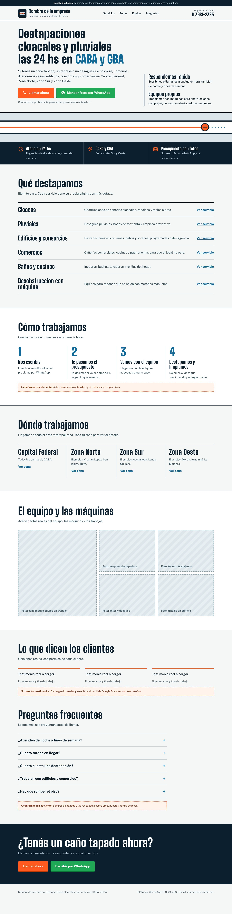
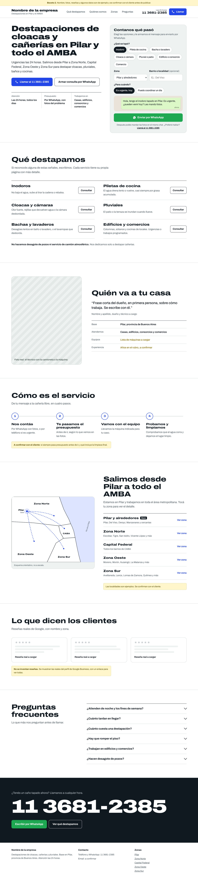
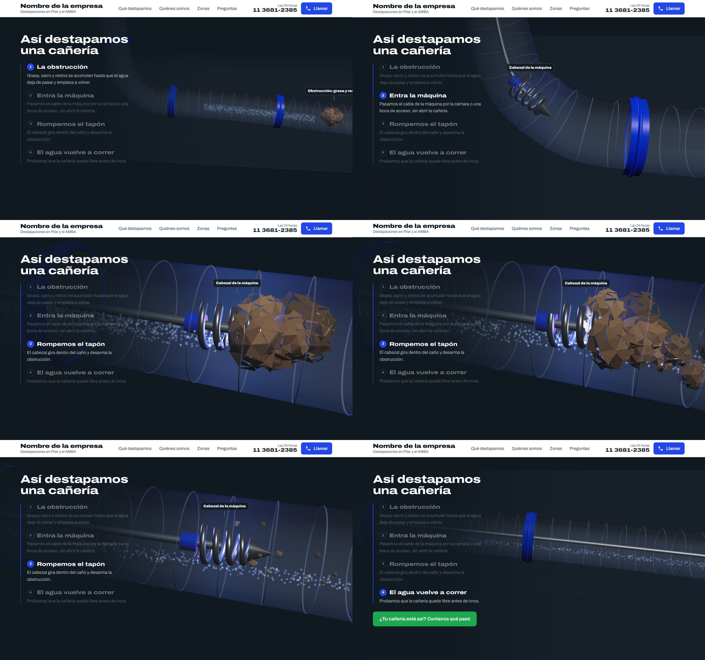
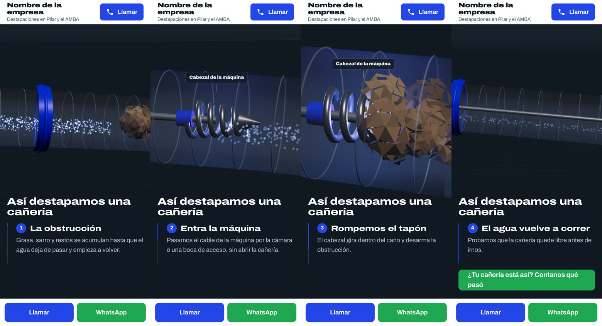

# Bocetos web: servicio de destapaciones

Tres bocetos de la página web para un servicio de destapaciones de cloacas, cañerías y pluviales con base en Pilar que trabaja en todo el AMBA.

Los textos, fotos, reseñas y algunos datos son de ejemplo. Cada boceto lo indica con una franja arriba y con notas en las secciones que hay que confirmar con el cliente antes de publicar.

## Cómo verlos

Cada boceto es un solo archivo `index.html`. Se abre con doble clic en cualquier navegador. Hace falta internet para cargar la tipografía y, en el boceto 3, la librería 3D.

| Boceto | Archivo | Qué tiene |
|---|---|---|
| 1 | [`boceto-1/index.html`](boceto-1/index.html) | Estilo industrial (azul y naranja). Cañería animada en el hero, servicios en filas, zonas, preguntas frecuentes y barra de llamada fija en el celular. |
| 2 | [`boceto-2/index.html`](boceto-2/index.html) | Estilo limpio (blanco y cobalto). Armador de consulta que escribe el mensaje de WhatsApp, problemas por síntomas, sección del técnico, mapa con Pilar como base y teléfono gigante al cierre. |
| 3 | [`boceto-3/index.html`](boceto-3/index.html) | El boceto 2 con una escena 3D que avanza con el scroll (Three.js) y animaciones: encabezado fijo, rutas del mapa que se dibujan, pasos que se completan y dígitos del teléfono que suben. |

## Capturas

**Boceto 1**

**Boceto 2**

**Boceto 3: escena 3D en seis momentos del scroll**

## Tecnología

HTML, CSS y JavaScript sin frameworks ni compilación. El boceto 3 usa [Three.js](https://threejs.org/) 0.160 desde una CDN. Todas las animaciones respetan la opción "reducir movimiento" del sistema, y el boceto 3 muestra los pasos como texto si el navegador no puede dibujar 3D.

## Pendiente antes de publicar

- Nombre de la empresa, email y fotos reales del equipo, las máquinas y los trabajos.
- Reseñas reales del perfil de Google Business. No se inventan.
- Localidades exactas de cada zona.
- Confirmar si siempre se pasa presupuesto antes de ir y si no hace falta romper pisos.
- Páginas propias por servicio y por zona, dominio definitivo, canonical, sitemap y medición de llamados.
